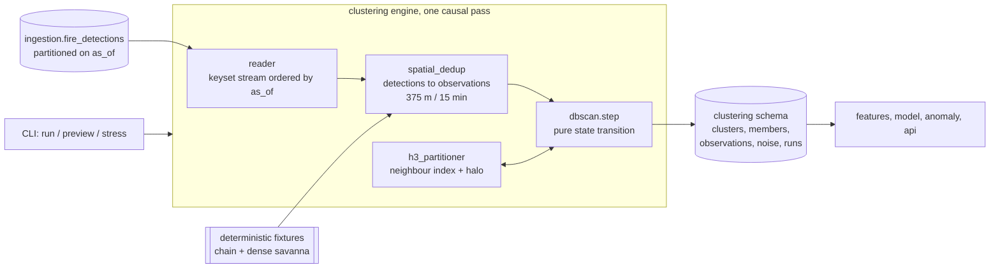

# Design Document: Clustering Engine

## Overview

The clustering engine is a Python package at `/clustering/`. It reads FIRMS detections from `ingestion.fire_detections`, groups them into persistent site-scale clusters, and writes them into a separate `clustering` schema in the same PostGIS database. Nothing else participates in cluster formation.

The engine is a single causal pass over observations in acquisition-time order. That single design decision delivers most of the requirements at once: causality is structural rather than a filter bolted on afterwards, replay determinism follows from processing order, and cluster accumulation across days falls out of keeping clusters open until they go idle.

Three deliberate deviations from textbook DBSCAN are central, and each is recorded in output metadata:

1. **Diameter-bounded growth.** A cluster may not exceed `max_cluster_diameter_m` (2000 m). Epsilon bounds the neighbourhood; this bounds the cluster.
2. **No cluster merging.** When an observation is reachable from two clusters, textbook DBSCAN merges them. Merging would break both the extent bound and cluster-identity stability, so the observation joins the nearest eligible cluster instead and the clusters stay separate.
3. **Streaming core-point determination.** Density is evaluated as observations arrive rather than over a complete batch, so a point's cluster-or-noise status is provisional until its linkage window closes.

Together these make the algorithm *causal diameter-bounded spatiotemporal DBSCAN*. It is not interchangeable with `sklearn.cluster.DBSCAN` or PostGIS `ST_ClusterDBSCAN`, and the design does not pretend otherwise.

### Why not an off-the-shelf implementation

| Option | Why it does not fit |
|---|---|
| PostGIS `ST_ClusterDBSCAN` | A window function over a complete set. No temporal linkage, no diameter bound, no incremental accumulation, and no way to express an immutable closed cluster. Inherently non-causal. |
| `sklearn.cluster.DBSCAN` | Batch only. Needs the whole range in memory, gives unbounded transitive chaining, and offers no cluster identity that survives across runs. |
| ST-DBSCAN as published | Adds a temporal epsilon but keeps batch semantics, unbounded chaining, and merge-on-reachability. |

All three would produce exactly the runaway clusters this spec exists to prevent. The engine therefore implements its own step function, and uses H3 only as a neighbour index rather than as an algorithm.

## Architecture



The reader, dedup stage and step function form a pipeline where each stage emits only finalized items to the next. The engine holds no database connection while computing on a batch.

### Two settling stages

Causality forces an explicit answer to "when is a decision final?" There are exactly two places where a decision must wait, and both are bounded and small relative to the 7-day scales:

| Stage | Waits for | Bound | Reason |
|---|---|---|---|
| Reconciliation | Later detections of the same fire | `reconcile_temporal_tolerance` (15 min) | A second satellite may see the same fire minutes later. |
| Cluster or noise assignment | A partner observation to satisfy `min_samples` | `max_linkage_gap_days` (7 days) | A lone observation is not yet a cluster and not yet noise. |

From these the engine derives a **settled horizon** for an evaluation time T:

```
settled_horizon(T) = T - max_linkage_gap - reconcile_temporal_tolerance
```

Everything with acquisition time at or before the settled horizon has a final assignment. Between the horizon and T, assignments are provisional. Reporting provisional state as final would be the dishonest option, so runs report settled clusters, settled noise and provisional pending observations as three distinct sets.

### Causality formalization

Two timestamps per cluster carry different meanings, and conflating them is what breaks replay tests:

- `first_detected`: the acquisition time of the earliest member. It can be earlier than the moment the cluster became knowable.
- `formed_at`: the acquisition time of the observation that completed `min_samples`, meaning the moment the cluster first existed to an observer.

The replay property (Requirement 3.5) is then precise. For an evaluation time T, the state as known at T is:

```
clusters   = { c : c.formed_at <= T },  members restricted to as_of <= T
noise      = { o : o unassigned and o.as_of <= settled_horizon(T) }
pending    = { o : o unassigned and settled_horizon(T) < o.as_of <= T }
```

For any T1 earlier than T2, the T2 run's view as of T1 must equal the T1 run's final output. This holds because every assignment decision for an observation depends only on state accumulated strictly before that observation, so both runs take identical decisions in identical order. A cluster that becomes knowable only after T1 is excluded by the `formed_at <= T1` filter rather than retroactively inserted into T1's history.

## Components and Interfaces

### Package layout

```
/clustering/
  __main__.py            CLI: run, preview, stress, migrate
  config/clustering.yaml non-secret defaults and stress scenarios
  core/
    params.py            validated parameter set + fingerprint
    geo.py              geodesic distance, bbox, incremental convex hull
    models.py            Observation, Cluster, ClusterState, RunSummary
    stats.py             size and extent distributions
  spatial_dedup.py       detections -> observations (causal, 375 m / 15 min)
  h3_partitioner.py      H3 neighbour index with validated halo
  dbscan.py              pure step function + engine driver
  reader.py              keyset-ordered detection stream from PostGIS
  writer.py              idempotent persistence into the clustering schema
  contract.py            cluster -> data-contracts.md JSON
  stress.py              scenario runner and assertions
  fixtures/              deterministic synthetic detection generators
  migrations/            Alembic revision for the clustering schema
  tests/
  README.md
```

Shared infrastructure is reused rather than duplicated: `ingestion.core.settings` for config loading and environment overrides, `ingestion.core.logging` for JSON logging and redaction, and `ingestion.core.db` for the pooled engine and retry helper. That is what Requirement 10.5 asks for. These modules are effectively a shared platform layer; if a third stage needs them they should be promoted to a `common` package, and the design notes that rather than pre-emptively refactoring.

### Parameters (core/params.py)

```python
@dataclass(frozen=True)
class ClusterParams:
    eps_m: float = 750.0                      # hard ceiling 750.0
    min_samples: int = 2
    inactivity_days: float = 7.0
    max_linkage_gap_days: float = 7.0          # defaults to inactivity_days
    max_cluster_diameter_m: float = 2000.0
    reconcile_spatial_m: float = 375.0
    reconcile_temporal_minutes: float = 15.0
    reconcile_enabled: bool = True
    h3_resolution: int = 6
    h3_ring: int = 1
    algorithm_version: str = "cdb-dbscan-1"

    def fingerprint(self) -> str: ...          # sha256 over all fields, 16 hex chars
```

Validation refuses to start on: `eps_m > 750.0`, `eps_m <= 0`, `min_samples < 1`, non-positive time bounds, `max_cluster_diameter_m < eps_m`, `reconcile_spatial_m > eps_m`, or an H3 resolution and ring whose halo cannot contain `eps_m`.

The halo check is computed rather than assumed. For the configured resolution the engine takes the smallest edge length reported by the H3 library, derives the hexagon inradius as `0.866 * edge`, and requires `h3_ring * inradius >= eps_m`. Resolution 6 clears 750 m with a wide margin; resolution 7 is close to the limit and is only permitted if it passes the same check. Failing this check is a configuration error, not a warning, because a truncated neighbourhood silently fragments clusters.

`fingerprint()` scopes results. It is part of cluster identity, so runs under different parameters never mix (Requirement 2.9).

### Geometry (core/geo.py)

- `distance_m(a, b)`: geodesic distance on WGS 84. Degrees are never treated as metres, so eps behaves identically in Punjab and in a savanna fixture.
- `Hull`: incremental convex hull over cluster members. The diameter of a point set equals the diameter of its convex hull, so the hull gives an exact extent while staying small for a 2 km cluster. Adding a point recomputes the hull over `hull ∪ {p}` by monotone chain, which is cheap at this size.
- `extent_m(hull)`: maximum geodesic distance between hull vertices.

Retaining a hull instead of every member is what keeps memory bounded for a flare that stays active for months.

### Reconciliation (spatial_dedup.py)

```python
def reconcile(detections: Iterable[Detection], params: ClusterParams) -> Iterator[Observation]
```

Detections arrive in acquisition-time order. Each open observation absorbs a later detection when it is within `reconcile_spatial_m` and `reconcile_temporal_minutes` of the observation's anchor. An observation is emitted once its temporal tolerance has elapsed, making it final before it reaches the clustering step.

The observation's position is its **anchor** detection's position, not a running centroid. A centroid would keep moving as detections were absorbed, adding a second source of provisional state for no real gain: the tolerance is 375 m, which is one VIIRS pixel and well inside a 750 m epsilon. The anchor is the earliest detection, with `(detection_id)` as the tiebreak for identical timestamps.

Observation fields: `observation_key`, anchor position and time, mean FRP over absorbed detections, day or night flag from the anchor, the absorbed detection identifiers, and the contributing products and satellites. `observation_key` is a deterministic hash of the anchor's natural key, so replays reproduce it.

With reconciliation disabled each detection becomes one observation and the run records that.

### Neighbour index (h3_partitioner.py)

An in-process map from H3 cell to the observations currently relevant for linkage, each tagged with its owner (a cluster id, or none while pending). Lookup for a candidate observation visits its own cell plus the configured ring, so a neighbour never sits outside the searched area.

The index is deliberately an index, not a work-splitting scheme. Sharding the run by H3 cell and clustering shards independently would change results at cell boundaries, which Requirement 10.2 forbids. Two entries are evicted: members of a cluster when it closes, and pending observations when they settle as noise.

### The step function (dbscan.py)

The core is pure, with no I/O, which is what makes the causality requirement directly unit-testable:

```python
def step(state: ClusterState, obs: Observation, params: ClusterParams) -> tuple[ClusterState, StepEffect]
```

`ClusterState` holds open clusters keyed by `cluster_id`, pending observations, the neighbour index, and the last processed timestamp. `StepEffect` reports what changed: clusters opened, observations admitted, clusters closed, observations settled as noise.

```
step(state, o, p):
    assert o.t >= state.last_t                      # input must be time-ordered

    # 1. Closure. Input is time-ordered, so an idle cluster can never be
    #    revived by o or anything after it.
    for c in state.open_clusters:
        if o.t - c.last_detected > p.inactivity_days:
            close(c)                                 # immutable from here

    # 2. Settle pending observations whose linkage window has closed.
    for q in state.pending:
        if o.t - q.t > p.max_linkage_gap_days:
            settle_as_noise(q)

    # 3. Candidate clusters: reachable, in time, and extent-safe.
    neighbours = index.lookup(o, radius=p.eps_m)      # own cell + ring
    eligible = []
    for c in clusters_of(neighbours):
        reach = min(distance_m(o, m) for m in recent_members(c) if o.t - m.t <= p.max_linkage_gap_days)
        if reach is None or reach > p.eps_m:
            continue
        if extent_after_adding(c.hull, o) > p.max_cluster_diameter_m:
            continue                                 # the diameter guard
        eligible.append((reach, c.cluster_id, c))

    # 4. Admit to the nearest eligible cluster. No merging: identity is stable
    #    and the extent bound is preserved. Ties break on cluster_id.
    if eligible:
        _, _, c = min(eligible, key=lambda e: (e[0], e[1]))
        admit(c, o)
        return

    # 5. No eligible cluster. Try to form a new one from pending neighbours
    #    that are close enough in space and time and fit the extent bound.
    partners = [q for q in pending_of(neighbours)
                if distance_m(o, q) <= p.eps_m
                and o.t - q.t <= p.max_linkage_gap_days]
    group = largest_extent_safe_group(o, partners, p)   # deterministic
    if len(group) >= p.min_samples:
        open_cluster(seed=earliest(group), members=group, formed_at=o.t)
    else:
        state.pending.add(o)
```

Properties worth calling out:

- Step 1 runs before step 3, so a closed cluster is never a candidate and never reopens (Requirements 6.6 and 6.7).
- Reachability is measured to cluster **members**, not to the centroid. Centroid distance would be leader clustering with different semantics.
- `recent_members(c)` only needs members within `max_linkage_gap_days`; older members cannot link to `o` regardless. The full member list is never required at runtime, only the hull and the running aggregates.
- Step 4 is where merging would normally happen. Choosing the nearest eligible cluster keeps `cluster_id` stable and the extent bounded. The cost is that adjacent dense burns become adjacent clusters, which Requirement 4.8 requires anyway.
- `largest_extent_safe_group` adds partners in ascending `(distance, observation_key)` order while the extent stays inside the bound, so the result does not depend on input ordering beyond the causal ordering.

`cluster_id` is derived as `sha256(algorithm_version || params.fingerprint() || seed.observation_key)` truncated to 20 hex characters, prefixed `c-`. Deterministic, stable across replays, and scoped to its parameter set.

Incremental per-cluster aggregates are all O(1): count, FRP sum and sum of squares, day and night counts, first and last detected, plus the hull.

### Reader (reader.py)

Detections stream in `(as_of, detection_id)` keyset order, filtered by the AOI bounding box, the date range and `as_of <= T`. Keyset pagination beats `OFFSET` on a partitioned table and gives a stable order. Batches are configurable; a connection is held only while fetching a batch, never during computation.

### Writer (writer.py)

Persistence is idempotent because `cluster_id` is deterministic. Clusters upsert on `cluster_id` with recomputed aggregates; members insert with `ON CONFLICT DO NOTHING`; noise observations upsert on `observation_key`. Re-running a range therefore converges instead of duplicating (Requirement 6.9).

Closed clusters are flushed as they close, so memory does not grow with the range length. Open clusters and pending observations are flushed at the end of the run with their current state and a provisional marker.

### Contract emission (contract.py)

Emits the `data-contracts.md` shape. Only the cluster identity, geometry, timing and `features.firms` are populated; every other feature block, plus `classification` and `anomaly`, is emitted as `null` for later stages (Requirement 7.7).

```json
{
  "cluster_id": "c-9f2a...",
  "centroid": {"lat": 30.7412, "lon": 75.8109},
  "bounding_box": {"min_lat": 30.737, "min_lon": 75.806, "max_lat": 30.745, "max_lon": 75.816},
  "first_detected": "2025-11-03T06:42:00Z",
  "last_detected": "2025-11-05T20:18:00Z",
  "detection_count": 14,
  "observation_count": 9,
  "features": {
    "firms": {"persistence_days": 2.58, "frp_mean": 42.4, "frp_var": 12.1,
              "day_night_ratio": 0.42, "as_of": "2025-11-05T20:18:00Z"},
    "land_cover": null, "osm": null, "no2": null, "optical": null, "wind": null
  },
  "classification": null,
  "anomaly": null,
  "algorithm": {
    "name": "causal diameter-bounded spatiotemporal DBSCAN",
    "version": "cdb-dbscan-1",
    "params_fingerprint": "8c1d5b2f9a4e7c30",
    "eps_m": 750.0, "min_samples": 2, "max_cluster_diameter_m": 2000.0,
    "extent_m": 1180.4, "diameter_bounded": true, "merging": "disabled",
    "formed_at": "2025-11-03T06:42:00Z", "status": "closed"
  }
}
```

`observation_count` and `algorithm` extend the contract; the contract's own fields keep their documented names and meanings. `detection_count` is the raw detection count, matching the field name literally, while `observation_count` exposes the reconciled figure (Requirement 5.5).

Feature definitions, each fixing the edge cases Requirement 7 demands:

| Field | Definition | Single-observation case |
|---|---|---|
| `persistence_days` | `(last_detected - first_detected)` in fractional days | `0.0` |
| `frp_mean` | arithmetic mean of observation FRP, deduped so sensor overlap cannot bias it | the single value |
| `frp_var` | population variance, `ddof = 0` | `0.0`, where sample variance would be undefined |
| `day_night_ratio` | `day_observations / total_observations`, so 0.0 is fully nocturnal and 1.0 fully diurnal | `0.0` or `1.0` |
| `features.firms.as_of` | latest member acquisition time, never the write time | that observation's time |

FRP statistics are computed over reconciled observations rather than raw detections, because averaging the same fire seen by VIIRS and MODIS would weight overlap zones more heavily than single-sensor coverage.

## Data Models

All tables live in a `clustering` schema with its own Alembic history, so ingestion and clustering migrate independently. The engine never writes to an ingestion table (Requirement 11.8).

Members reference detections by the logical pair `(detection_id, as_of)` with no foreign key. A real FK to a partitioned table that ingestion may detach or reprocess would couple the stages' DDL together for no correctness gain here.

Creation order matters: `runs` is created first because clusters and noise reference it.

```sql
CREATE TABLE clustering.runs (
  run_id             uuid        PRIMARY KEY,
  status             text        NOT NULL CHECK (status IN ('running', 'succeeded', 'failed', 'skipped')),
  aoi                text        NOT NULL,
  window_start       timestamptz NOT NULL,
  window_end         timestamptz NOT NULL,        -- exclusive
  evaluation_time    timestamptz NOT NULL,
  settled_horizon    timestamptz NOT NULL,
  params             jsonb       NOT NULL,
  params_fingerprint text        NOT NULL,
  algorithm_version  text        NOT NULL,
  products           text[]      NOT NULL,
  detections_read    integer     NOT NULL DEFAULT 0,
  observations       integer     NOT NULL DEFAULT 0,
  clusters_open      integer     NOT NULL DEFAULT 0,
  clusters_closed    integer     NOT NULL DEFAULT 0,
  noise_count        integer     NOT NULL DEFAULT 0,
  pending_count      integer     NOT NULL DEFAULT 0,
  max_extent_m       double precision,
  duration_s         double precision,
  started_at         timestamptz NOT NULL DEFAULT now(),
  finished_at        timestamptz,
  error_summary      text
);

CREATE TABLE clustering.clusters (
  cluster_id        text        PRIMARY KEY,
  params_fingerprint text       NOT NULL,
  algorithm_version text        NOT NULL,
  status            text        NOT NULL CHECK (status IN ('open', 'closed')),
  aoi               text        NOT NULL,
  formed_at         timestamptz NOT NULL,          -- when it became knowable
  first_detected    timestamptz NOT NULL,          -- earliest member
  last_detected     timestamptz NOT NULL,
  closed_at         timestamptz,                   -- acquisition-time closure
  centroid          geometry(Point, 4326) NOT NULL,
  min_lat           double precision NOT NULL,
  min_lon           double precision NOT NULL,
  max_lat           double precision NOT NULL,
  max_lon           double precision NOT NULL,
  extent_m          double precision NOT NULL,
  detection_count   integer     NOT NULL CHECK (detection_count > 0),
  observation_count integer     NOT NULL CHECK (observation_count > 0),
  frp_mean          real        NOT NULL,
  frp_var           real        NOT NULL,
  day_night_ratio   real        NOT NULL CHECK (day_night_ratio BETWEEN 0 AND 1),
  persistence_days  real        NOT NULL CHECK (persistence_days >= 0),
  features_as_of    timestamptz NOT NULL,
  provisional       boolean     NOT NULL DEFAULT false,
  run_id            uuid        NOT NULL REFERENCES clustering.runs(run_id),
  created_at        timestamptz NOT NULL DEFAULT now(),
  updated_at        timestamptz NOT NULL DEFAULT now(),
  CONSTRAINT clusters_extent_non_negative CHECK (extent_m >= 0)
);
-- The 2000 m ceiling is a configured parameter, not a literal, so it cannot be a
-- static CHECK. It is enforced during admission and re-verified for every cluster
-- before persistence, which aborts the run on violation (Requirement 4.5).
CREATE INDEX ON clustering.clusters USING gist (centroid);
CREATE INDEX ON clustering.clusters (params_fingerprint, status, last_detected);
CREATE INDEX ON clustering.clusters (formed_at);

CREATE TABLE clustering.observations (
  observation_key   text        PRIMARY KEY,
  params_fingerprint text       NOT NULL,
  lat               double precision NOT NULL,
  lon               double precision NOT NULL,
  geom              geometry(Point, 4326)
                    GENERATED ALWAYS AS (ST_SetSRID(ST_MakePoint(lon, lat), 4326)) STORED,
  as_of             timestamptz NOT NULL,
  frp               real        NOT NULL,
  day_night         char(1)     NOT NULL CHECK (day_night IN ('D', 'N')),
  detection_count   integer     NOT NULL CHECK (detection_count > 0),
  products          text[]      NOT NULL,
  satellites        text[]      NOT NULL
);
CREATE INDEX ON clustering.observations USING gist (geom);
CREATE INDEX ON clustering.observations (as_of);

CREATE TABLE clustering.cluster_members (
  cluster_id      text        NOT NULL REFERENCES clustering.clusters ON DELETE CASCADE,
  observation_key text        NOT NULL REFERENCES clustering.observations,
  as_of           timestamptz NOT NULL,           -- enables as-of replay views
  PRIMARY KEY (cluster_id, observation_key)
);
CREATE INDEX ON clustering.cluster_members (cluster_id, as_of);

CREATE TABLE clustering.observation_detections (
  observation_key text        NOT NULL REFERENCES clustering.observations ON DELETE CASCADE,
  detection_id    bigint      NOT NULL,           -- logical ref to ingestion.fire_detections
  detection_as_of timestamptz NOT NULL,
  product         text        NOT NULL,
  satellite       text        NOT NULL,
  PRIMARY KEY (observation_key, detection_id, detection_as_of)
);

CREATE TABLE clustering.noise_observations (
  observation_key    text        PRIMARY KEY REFERENCES clustering.observations,
  params_fingerprint text        NOT NULL,
  as_of              timestamptz NOT NULL,
  settled_at         timestamptz NOT NULL,        -- acquisition-time settlement
  run_id             uuid        NOT NULL REFERENCES clustering.runs(run_id)
);
CREATE INDEX ON clustering.noise_observations (as_of);
```

### As-of replay view

Because members carry `as_of` and clusters carry `formed_at`, the state as known at any T1 is a query rather than a stored snapshot:

```sql
CREATE FUNCTION clustering.clusters_as_of(at timestamptz, fingerprint text)
RETURNS TABLE (cluster_id text, observation_count bigint,
               first_detected timestamptz, last_detected timestamptz) AS $$
  SELECT c.cluster_id, count(*), min(m.as_of), max(m.as_of)
  FROM clustering.clusters c
  JOIN clustering.cluster_members m USING (cluster_id)
  WHERE c.params_fingerprint = fingerprint
    AND c.formed_at <= at
    AND m.as_of <= at
  GROUP BY c.cluster_id
$$ LANGUAGE sql STABLE;
```

This is what the integration-level replay test compares against a fresh run at T1.

## Configuration

`clustering/config/clustering.yaml`, with the same `INGEST__`-style environment override mechanism the ingestion layer uses. Database credentials continue to come only from `DATABASE_URL`.

```yaml
aois:
  india: [68.0, 6.5, 97.5, 37.5]
default_aoi: india

params:
  eps_m: 750.0                    # hard ceiling: 750.0
  min_samples: 2
  inactivity_days: 7.0
  max_linkage_gap_days: 7.0
  max_cluster_diameter_m: 2000.0
  reconcile_spatial_m: 375.0
  reconcile_temporal_minutes: 15.0
  reconcile_enabled: true
  h3_resolution: 6
  h3_ring: 1

runtime:
  batch_size: 20000
  flush_every: 5000

stress:
  scenarios:
    - name: india_stubble_nov2025
      description: Dense multi-event stubble burning in Punjab, Haryana and western UP.
      source: store
      aoi: india
      start: 2025-11-01
      end: 2025-11-20
      expect:
        max_extent_m: 2000.0
        max_observations_per_cluster: 400
        min_clusters: 50
        max_mean_observations_per_cluster: 40.0
    - name: india_sparse_sep8_2026
      description: Late-monsoon Indian sparsity; isolated detections must not merge.
      source: store
      aoi: india
      start: 2026-09-08
      end: 2026-09-08
      expect:
        max_extent_m: 2000.0
        max_observations_per_cluster: 100
        report_noise_fraction: true
    - name: savanna_dense_sep8_2026
      description: Synthetic high-density savanna burning. Fixture, not observed data.
      source: fixture
      fixture: dense_savanna_grid
      start: 2026-09-08
      end: 2026-09-08
      expect:
        max_extent_m: 2000.0
        min_clusters: 100
    - name: chain_runaway_guard
      description: Detections 700 m apart along a 20 km line; plain DBSCAN yields one cluster.
      source: fixture
      fixture: linear_chain_20km
      expect:
        max_extent_m: 2000.0
        min_clusters: 10
```

## CLI and stress harness

```
python -m clustering run     --start YYYY-MM-DD --end YYYY-MM-DD [--aoi NAME]
                             [--eval-time ISO8601] [--eps-m F] [--min-samples N]
                             [--inactivity-days F] [--max-diameter-m F]
                             [--products A,B] [--json]
python -m clustering preview --start ... --end ...      # compute and report, persist nothing
python -m clustering stress  [--scenario NAME] [--json]
python -m clustering migrate
```

`--start` and `--end` are inclusive calendar dates; the run prints the resulting half-open UTC interval. `--eval-time` defaults to the end of that interval.

The run summary reports the effective parameters, the input detection count, the reconciled observation count, cluster counts split into open and closed, the noise and pending counts, the size distribution (min, median, p90, p99, max, and a histogram), the extent distribution against the configured limit, and the wall-clock duration. `--json` emits the same content machine-readably so parameter sweeps can be diffed.

The stress harness runs each scenario and prints a per-scenario verdict. A store-backed scenario with no detections in range reports `skipped` with the reason rather than passing or failing (Requirement 9.11). Any failed expectation exits non-zero so a build can gate on it.

The two fixture scenarios are what actually prove the diameter guard, and they run with no database and no credentials:

- `linear_chain_20km` places detections every 700 m along a 20 km line inside one linkage window. Every consecutive pair is within epsilon, so textbook DBSCAN returns exactly one cluster about 20 km across. The engine must return at least 10 clusters, none exceeding 2 km. This is the direct regression test for the flaw the requirements identified.
- `dense_savanna_grid` places a deterministic pseudo-random grid of detections at roughly 400 to 700 m spacing across about 30 by 30 km, seeded so the output is reproducible. Textbook DBSCAN collapses it into one cluster spanning the whole block; the engine must tile it into many bounded clusters.

Both generators are labelled synthetic in their output and in the run record, so fixture results are never mistaken for observed savanna data.

## Correctness Properties

Each property is stated so it can be tested, and names the requirement it validates.

**Property 1: Epsilon ceiling.** Any configuration with `eps_m > 750.0` is rejected before any detection is read. *Requirement 2.2*

**Property 2: Geodesic epsilon.** Two detections separated by a fixed ground distance are either both inside or both outside epsilon, regardless of latitude. *Requirement 2.4*

**Property 3: Extent bound.** For every persisted cluster, the maximum geodesic distance between any two members is at most `max_cluster_diameter_m`. *Requirements 4.2, 4.5*

**Property 4: Chain resistance.** For a chain of detections spaced strictly between 0 and `eps_m` apart and spanning more than `max_cluster_diameter_m`, the engine returns more than one cluster and every cluster respects the bound. *Requirements 4.3, 9.6*

**Property 5: Run determinism.** The same input set, evaluation time and parameters produce identical cluster identifiers, memberships and aggregates across repeated runs. *Requirement 3.4*

**Property 6: Replay prefix.** For T1 earlier than T2 over one input stream, the T2 run's view as of T1 equals the T1 run's output, where noise at T1 is restricted to observations at or before `settled_horizon(T1)`. *Requirement 3.5*

**Property 7: No forward influence.** Removing every observation after T from the input leaves the state at T unchanged. *Requirements 3.1, 3.3*

**Property 8: Closure is final.** After a gap exceeding `inactivity_days`, a later nearby observation opens a new cluster and the closed cluster's membership, timing and features are untouched. *Requirements 6.6, 6.7*

**Property 9: Reconciliation collapses overlap.** Detections of one fire by different satellites within the reconciliation tolerances yield one observation, whose `detection_count` equals the number of detections. *Requirements 5.1, 5.4, 5.5*

**Property 10: Partitioning neutrality.** Clustering with the H3 index and with a brute-force neighbour search over the same input produces identical memberships. *Requirement 10.2*

**Property 11: Halo sufficiency.** For the configured resolution and ring, no observation within `eps_m` of a candidate falls outside the searched cells. *Requirement 10.3*

**Property 12: Idempotent persistence.** Running the same range twice leaves one row per cluster, member and noise observation, with identical aggregates. *Requirement 6.9*

**Property 13: Feature definitions.** `persistence_days`, `frp_mean`, `frp_var` and `day_night_ratio` match their documented formulas, including the single-observation cases. *Requirements 7.2 to 7.5*

**Property 14: Contract completeness.** Every emitted cluster carries the contract's required fields, with `features.firms` populated and the enrichment, classification and anomaly blocks null. *Requirements 7.1, 7.7*

**Property 15: Identity stability.** A cluster keeps its identifier as it admits further observations across successive runs. *Requirement 6.3*

## Error Handling

| Condition | Behaviour | Run status | Log level |
|---|---|---|---|
| `eps_m` above the ceiling, or any invalid parameter | Refuse to start before reading data | not created | ERROR, exit 2 |
| H3 halo cannot cover epsilon | Refuse to start | not created | ERROR, exit 2 |
| `DATABASE_URL` missing | Refuse to start, naming the variable | not created | ERROR, exit 2 |
| Clustering schema not migrated | Refuse to start, pointing at `migrate` | not created | ERROR, exit 2 |
| No detections in range | Report zero clusters, persist nothing | succeeded | INFO |
| Input arrives out of acquisition order | Abort the run; the causal contract is broken | failed | ERROR |
| Extent invariant violated at persist time | Abort before writing the violating cluster | failed | ERROR |
| Transient database error | Retry with bounded backoff via the ingestion helper | retried, then failed | WARNING, then ERROR |
| Stress expectation unmet | Report the scenario verdict and continue to the next | succeeded run, failing verdict, exit 1 | ERROR |
| Store-backed scenario with no data | Report skipped with the reason | skipped | INFO |
| Interrupted | Best-effort mark the run failed; persisted clusters stay intact | failed | WARNING |

Every error summary passes through the ingestion layer's redaction before it is logged or stored.

## Testing Strategy

- **Unit tests, no database and no network.** The step function against hand-built observation streams: closure, no reopening, nearest-cluster admission, extent refusal, pending settlement, deterministic identifiers. Geodesic distance and hull extent. Reconciliation. Feature formulas including single-observation cases. Parameter and halo validation.
- **Property tests.** Properties 1 to 11 and 13 with Hypothesis over generated observation streams, including adversarial chains and grids.
- **Fixture scenarios.** `linear_chain_20km` and `dense_savanna_grid` as regression tests for the runaway-merge flaw, runnable in CI.
- **Integration tests against PostGIS.** Idempotency, the `clusters_as_of` replay view against a fresh T1 run, member and noise persistence, and run bookkeeping. Skipped when no test database is reachable.
- **Store-backed stress scenarios.** Opt-in, requiring the November 2025 India backfill to have been ingested. These are the only tests that need real data, and they skip cleanly without it.

## Performance

For a 20-day dense India range the input is on the order of 10^5 to 10^6 detections. Per observation the work is one H3 lookup over a small neighbourhood plus an O(k) scan of recent members and a hull update, so the pass is effectively linear in observations with a small constant.

Memory is bounded by the active set rather than the range: recent members within the linkage window, plus one hull and a fixed set of aggregates per open cluster, plus pending observations within the linkage window. Closed clusters are flushed and evicted immediately. A flare active for months therefore costs a hull and a counter, not a growing member list.

Database work is batched reads through keyset pagination and batched idempotent writes, with no connection held during computation. The clustering process declares its pool share so it can be counted against the shared connection budget alongside ingestion jobs and backfills.

DuckDB is noted in the steering stack for cold historical queries. It is not used here; a future large-range replay path could read Parquet exports through DuckDB without changing the step function, since the reader is the only stage that touches storage.

## Risks and Deviations

1. **Documented DBSCAN deviation.** Diameter bounding and disabled merging mean results will not match a reference DBSCAN implementation on the same points. This is intentional, recorded per cluster in the `algorithm` block, and the reason a published implementation was not used.
2. **Boundary sensitivity in dense fields.** In a continuous burning belt, where a cluster boundary falls depends on causal arrival order. Cluster identity is stable for a given input set, but adding earlier-arriving data can shift boundaries. This is inherent to bounding the extent of a genuinely continuous phenomenon, and it is why the stress scenarios assert distributions rather than exact cluster counts.
3. **Event-time replay drift.** With knowledge-time bounding deliberately out of scope, replaying a range after standard-processing backfill can change results because the input changed. Runs record their evaluation time so a comparison can distinguish an input change from an algorithm change.
4. **`min_samples` of 2.** Two nearby detections within seven days form a cluster, which will admit some coincidental pairs. Settled noise is persisted, so the tradeoff can be measured by comparing noise and cluster counts across sweeps rather than argued.
5. **Fixture realism.** The savanna scenario proves the algorithm's behaviour under synthetic density, not its agreement with real savanna fire geometry. It is labelled synthetic everywhere it appears. Validating against real savanna data would require expanding the ingestion area of interest, which this spec deliberately does not do.
6. **Provisional tail.** Clusters and observations newer than the settled horizon are reported as provisional. Downstream consumers that ignore the `provisional` flag may act on assignments that later change within the linkage window.
